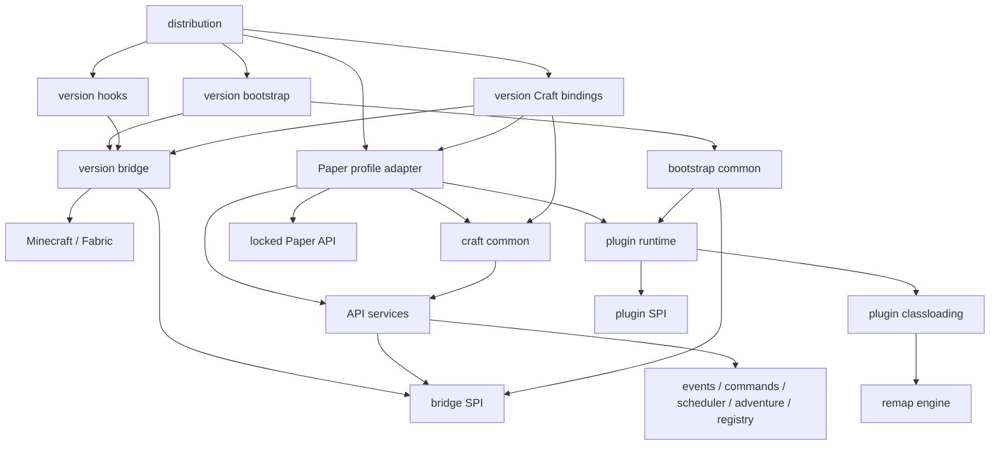
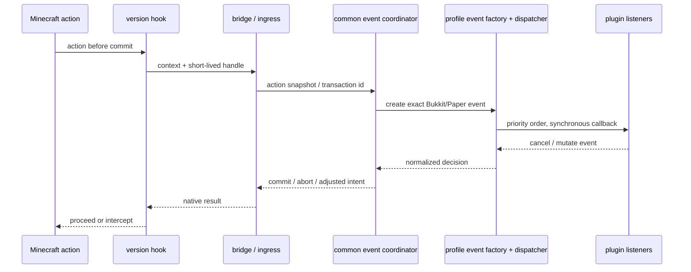

# Meldrite 整体架构设计

- 日期：2026-10-05
- 状态：设计交付；没有实现或宣称通过任何服务器兼容测试
- 首个实现：Minecraft Java 1.20.1，Fabric，Java 17
- 第二个实现：Minecraft Java 1.21.1，Fabric，Java 21
- 阅读顺序：本文 → [实施总计划](../plans/2026-10-05-meldrite-implementation.md) → 对应子计划
- 证据：[调研来源与适用范围](2026-10-05-meldrite-research.md)

## 1. 目标、范围与核心决策

Meldrite 是从零设计的 Fabric 混合服务端。它向插件提供明确版本的 Bukkit / Spigot / Paper contract，将 Minecraft 接入放在独立版本实现中，以可测试的公共服务承担行为。当前工作区只存放设计成果；本文的目标目录均指未来独立的 Meldrite 仓库，不表示沿用 Taiyitist 的模块、源码、构建或技术债。

本设计选择“公共服务 + API contract family adapter + Minecraft version implementation”三条轴。API 版本与 Minecraft 版本通常一同变化，但不是同一个维度：事件构造器、接口新增方法、插件 bootstrap API 属于 API family；NMS 类型、数据组件、网络包、注入点属于 Minecraft implementation。两者由发行清单组成一个确定产品。

### 1.1 不可违背的约束

1. 当前实际实现以 Minecraft 1.20.1 为主；从第一天开始预留 Minecraft 1.21.1 支持能力。
2. 公共代码不得依赖 Minecraft、Fabric Loader、Mixin、CraftBukkit 或具体 NMS mapping 类型；禁止在公共业务中写 `if version == ...`。
3. Paper API 兼容是固定上游构件的 API/ABI contract。API JAR 中存在方法不等于服务端已实现其语义。
4. 公共 Runtime、ClassLoader 算法、事件派发、Scheduler、Adventure 服务、Registry 映射和 Craft delegate 只保留一套实现。
5. Mixin 只承担生命周期接入、状态访问和必要拦截；事件构造、监听器排序、插件策略、命令解析与兼容补丁不得写入 Mixin。
6. 普通 API 插件不经过 NMS 重映射；同版本 NMS 映射不承诺把其他 Minecraft 版本的插件升级过来。
7. Fabric Mod 与插件分属不同加载规则；类加载可见性控制不宣称为恶意代码安全沙箱。
8. Adventure 是基础能力，统一类身份、组件语义、序列化及发送边界。
9. 不静默把 Mod 物品、方块或未知持久化内容替换为 AIR、STONE 或其他近似原版内容。
10. 每个兼容声明必须同时指向 contract、功能状态和回归证据；任何生产关键 hook 缺失都阻止该发行版进入 READY。

### 1.2 方案比较

| 方案 | 优点 | 长期代价 | 决策 |
|---|---|---|---|
| 直接移植整套 Craft/Paper 并以 Mixin 修补 | 前期容易接近具体上游行为 | NMS、Craft、插件运行时、补丁一起随版本漂移 | 不作为核心架构 |
| 对所有 API 自动生成转发、把差异藏进通用动态代理 | 表面统一、容易生成符号 | 丢失行为、类型与生命周期约束，生成器可能制造另一套大框架 | 仅用于机械签名与委托代码 |
| 公共行为服务 + 精确 API adapter + 独立游戏版本实现 | 隔离两类版本差异，行为可脱离 MC 测试 | 前期必须定义端口和契约，需要两种适配器 | 采用 |

不做通用“任意版本 Minecraft”引擎、不在一个进程同时加载两套 Minecraft、不承诺 Folia 区域线程语义、不支持生产热卸载/`/reload` 插件、不模拟所有 Paper internals。保留标准 API 中存在的调用入口，但是否可用必须在功能表中明确，而不是返回伪造成功。

## 2. 兼容合同与发布口径

### 2.1 Contract profile

每个发行版只选择一个 profile：`paper-1.20.1` 或 `paper-1.21.1`。profile 包含精确 Paper API artifact、继承的 Bukkit/Spigot API、传递的公共类型依赖、源码 commit、ABI 索引及行为规范。不得同时装入两版 `org.bukkit.*`。

API 工件从 `io.papermc.paper:paper-api:<MC>-R0.1-SNAPSHOT` 解析历史 timestamp/build 后固化；SNAPSHOT 字符串不能单独成为发布基线。首次 contract 任务生成并提交 `contracts/locks/paper-1.20.1.lock.json`，包含解析后的唯一版本、URL、SHA-256、POM 和传递依赖摘要、上游源码 commit。构建和 CI 只消费 lock，禁止自动追踪 latest。1.21.1 有独立 lock，不拿 1.20.1 ABI 假冒其 API。

本轮是架构设计，没有生成已下载 API 二进制的 SHA，因此不存在“已经锁定并验证 API”的承诺。锁定是实现阶段的第一个发布前置门禁，不允许绕过。

### 2.2 兼容层级

| 等级 | 插件访问范围 | Meldrite 承诺 | 检查方式 |
|---|---|---|---|
| A：标准 API | Bukkit/Spigot/Paper 公共 API，含 Adventure | 目标 profile 的完整符号面；已公布功能集合的实际行为 | ABI/linkage + 行为 + 插件回归 |
| B：Craft | 明确支持的 Craft 类、构造/成员、`getHandle()` | 限定 MC/profile 的白名单 ABI；超出部分不保证 | Craft ABI manifest + typed fixture |
| C：NMS | 游戏类、字段、方法、部分反射 | 同 MC 版本、已知 source namespace、支持的映射路径 | 映射 golden + 真服插件 fixture |
| D：Paper internals | Paper 服务端实现、补丁添加的私有结构/算法 | 默认不支持；仅逐项声明兼容扩展 | 插件指纹 + 扩展测试 + 独立风险记录 |

不能用包前缀判定 API：`io.papermc.paper.*` 同时包含公共 API 与实现相关类型。是否公共 API 由锁定 API artifact 中的符号索引判断；`com.destroystokyo.paper.*` 等历史公共包同样进入索引。Fabric Mod 不属于以上插件等级。

插件同时触及多个等级时取其全部需求集合。静态扫描只形成需求线索，不能证明反射、动态字节码或条件加载的完整需求。无法判定的插件允许在明确策略下加载，但未授权的内部访问失败要报告具体符号，不能自动打开所有实现包。

### 2.3 符号完整与语义覆盖分开发布

- `abi-surface`：检查 public/protected 类、成员、描述符、继承、默认方法、静态性、访问标志、泛型签名、注解、枚举常量和相关资源；ABI 与 source API 差异分别报告。
- `implementation-bindings`：每个需服务器提供的操作都绑定到服务或明确的 unsupported 状态；不得靠 API JAR 自身存在就记为已实现。
- `behavior-coverage`：支持项拥有线程、生命周期、错误、取消、序列化等测试；不能以空实现、`return null` 或吞异常达到覆盖率。
- `plugin-matrix`：固定插件版本、JAR hash、配置、MC、profile、Mod 集合 hash、场景、结果和日志。

功能状态为 `SUPPORTED`、`PARTIAL`、`UNSUPPORTED`、`NOT_APPLICABLE`；PARTIAL 必须枚举具体限制。开发里程碑可包含 unsupported 功能，但只能称“基于 Paper <profile> contract 的开发预览”，不能称完整 Paper 兼容。目标完整 contract 仍是统一 API 面，不因某个插件报错临时改变。

新增 API 差异先更新 inventory/测试/绑定，再实现行为；兼容 hack 不得向公共 API 偷塞新成员。

## 3. 模块、目录与依赖规则

这是逻辑模块清单，初期不要求每个功能一个独立发布 JAR。Gradle 子项目用于编译边界；包与测试夹具用于进一步划分责任。只发布 API、发行版和必要扩展，避免让内部模块变成插件依赖。

```text
meldrite/
  build-logic/                     Gradle convention、依赖边界和验证任务
  contracts/
    locks/                         两个 Paper profile 与公共依赖锁
    profiles/paper-1.20.1/          ABI、功能绑定、生命周期规范
    profiles/paper-1.21.1/          第二 profile 的独立合同
    schemas/                       配置/诊断/扩展 manifest 的 schema
  modules/
    foundation/                    ID、句柄、快照、生命周期、诊断值
    bridge-spi/                    面向能力的游戏端口；不含实现
    extension-api/                 Meldrite 给插件/Mod 的稳定扩展 API
    plugin-spi/                    中性描述、加载需求、生命周期宿主接口
    plugin-runtime/                发现、依赖图、生命周期、资源所有权
    plugin-classloading/            类/资源路由、隔离、library realm、缓存
    api-services/                  Bukkit/Paper 操作的公共业务服务
    craft-common/                  Craft wrapper 的公共 delegate 与身份缓存
    events/                        排序、取消、重入规则、监听器所有权
    commands/                      命令注册、冲突、权限与来源模型
    scheduler/                     tick 队列、异步池、任务取消
    adventure/                     Audience 路由、组件、序列化、发送策略
    registry/                      命名空间身份、快照、投影和缓存失效
    remap-engine/                  纯转换计划、字节码变换、缓存校验
    compatibility-spi/             受限扩展点与适用条件
    compatibility-engine/          匹配、排序、冲突、审计、开关
    bootstrap-common/              中性启动编排、健康检查、停止编排
  adapters/
    paper-1.20.1/                  精确 API 实现、事件对象和 JavaPlugin 握手
    paper-1.21.1/                  API 签名/语义差异的薄适配
  versions/
    v1_20_1/
      bridge/                      端口实现、NBT、网络、registry 接入
      hooks/                       Mixin、access widener、必要状态接口
      craft-bindings/              Craft FQCN、typed getHandle、版本成员
      mappings/                    命名空间图、继承元数据、校验摘要
      bootstrap/                   Fabric entrypoint、加载阶段接入
    v1_21_1/
      bridge/ hooks/ craft-bindings/ mappings/ bootstrap/
  compat-packs/                    每个已知问题独立 manifest、变换和回归
  distributions/
    mc-1.20.1/                     一个 profile + 一个 version implementation
    mc-1.21.1/                     第二发行物；不与第一个混装
  testkit/
    contract/                      ABI 与绑定审计工具
    fixtures/                      自有插件、Mod、依赖冲突夹具
    runtime/                       无 Minecraft 的行为测试辅助
    integration/                   外部 JVM、Fabric/Paper 差分运行器
  docs/adr/                        决策记录、上游变更和兼容策略
```

### 3.1 允许的编译依赖

箭头表示“依赖”，图中省略所有模块对 foundation 的依赖；没有画出的跨层依赖默认禁止。



`remap-engine` 可以用 ASM、mapping-io 等库，不能链接活的 Minecraft 类。`plugin-classloading` 仅依赖 remapper 的中性接口；A 类插件选择 identity 路径，remapper实现不必初始化。`compatibility-engine` 只调用 SPI；通过组合根把扩展注入明确节点，核心模块不得反向依赖 compat-packs。

`hooks` 可调用版本内部 `HookGateway`，它只接受转换后的值/短期句柄并调用已注册端口回调；不能 import adapters、plugin-runtime、org.bukkit 或具体兼容包。versions 内部允许必要的互相协作，但 Gradle 编译依赖仍保持无环。

### 3.2 API implementation 与 Craft 的分工

- `api-services`：权限、世界/实体操作的规则、配置/PDC 语义、事务协调等公共实现。只接受中性 ID、句柄和参数。
- `adapters/paper-*`：精确实现该 profile 的 `Server`、`World`、`Player` 等接口；构造其 Event；转换 Bukkit 参数和返回类型；实现 profile 的插件入口握手。业务委托给公共服务。
- `craft-common`：wrapper 身份缓存、失效控制、公共访问逻辑；使用内部 `EntityDelegate` / `WorldDelegate`，不能直接 import 两版 `Player` 或具体 Craft 包。
- `craft-bindings`：向插件提供必须是 Craft 具体类型的对象；继承/组合 profile 的基础 adapter，并持有正确的 NMS handle。`getHandle()` 的返回描述符、公开字段、静态转换方法在此验证。
- 发行版提供 `FacadeFactory`，让 `Bukkit.getServer()`、实体和世界工厂返回同一对象体系。禁止创建一套 API wrapper 再创建不相等的 Craft wrapper。

生成器只能生成从 ABI inventory 推导的签名、委托和 inventory，不生成业务语义。API 改动不能靠一次运行时反射代理“自动兼容”。profile 专用语义规则允许很小的有名策略对象；通用业务算法必须回到公共模块。

### 3.3 强制边界检查

编译后扫描常量池、字段/方法签名、注解和公开 ABI，禁止公共模块引用 `net.minecraft.*`、`net.fabricmc.*`、`org.spongepowered.*`、`org.bukkit.craftbukkit.*`。公共中性模块同样禁止 `org.bukkit.*`；profile adapter 是允许区。Adventure 的稳定 API 可用于 adventure 与 extension-api，但依赖版本必须属于 profile 公共依赖合同。

规则覆盖字符串形式的 NMS/Craft 类名，并设置小范围有理由的工具类例外；`jdeps` 仅为辅助，不能替代常量池/资源扫描。公共目录搜索游戏版本字符串和按版本判断只能作为 lint，最终通过类型依赖、重复代码检查和审查保证。

## 4. 稳定端口与数据模型

端口按能力拆分，不建立一个含数千方法的 `MinecraftBridge`。`BridgeBundle` 只在组合根枚举版本实现支持的端口，业务用构造注入获得自己需要的一小组。

| 端口/模型 | 职责与生命周期 | 不允许暴露 |
|---|---|---|
| `ServerLifecyclePort` | 启动阶段、tick、安全停止、主线程判定 | MinecraftServer、Fabric 事件类 |
| `WorldPort` / `EntityPort` | 世界/实体操作、有效性、所属线程 | ServerWorld、ServerPlayer |
| `InventoryPort` / `ItemCodecPort` | 快照、原子变更、版本编码与未知数据保留 | NMS ItemStack、CompoundTag、DataComponentType |
| `RegistryPort` | 按 key 解析、范围、epoch、冻结状态 | raw ID、活的 RegistryEntry |
| `NetworkAudiencePort` | component、title、action bar、bossbar 的发送效果 | 网络 packet 类型 |
| `CommandTreePort` | 对接 MC 命令树、来源转换和树更新 | Brigadier 节点泄漏到 common |
| `EventIngressPort` | 游戏动作快照、同步决策、结果提交 | Bukkit Event |
| `ExecutionPort` | 主线程排队、tick 时间与关闭屏障 | Fabric executor |
| `DataFixPort` | 原生版本数据迁移、上下文绑定与失败返回 | 业务内自写 DFU |

`ResourceKey = registry namespace:path + entry namespace:path`；registry 本身也有命名空间身份。`WorldKey` 不等于显示名称。`EntityHandle` 包含 world ID、实体 UUID、generation；旧实体移除后复用数字 ID 不能让旧 wrapper 指向新实体。世界卸载后只允许读取明确的快照属性，活操作返回 `STALE_HANDLE`。

`ItemSnapshot` 保存逻辑物品 ID、数量、可读属性，以及带版本/codec ID 的 opaque payload。opaque payload 是可保存但不可由公共层解释的值；不能用公共 NBT Map 假装覆盖两代物品系统。修改已知字段必须与原始载荷合并，保持未知 Mod 数据；无法保证无损就拒绝写入。

`CapabilitySet` 表达语义能力，例如 `item.components.structured`、`registry.reload.tags`，不表达 `is121`。能力主要在组装时选择实现；业务的能力检查用于可选功能，不用能力名伪装版本分支。端口异常携带错误码、资源 ID、阶段与诊断 cause；profile adapter 决定转换成其契约要求的异常类型。

## 5. 启动、停机与生命周期

Fabric Loader 是游戏/Mod 类转换的所有者。Meldrite 作为 Fabric mod 接入其生命周期；launcher 只选择发行物、检查 JDK/锁定依赖并启动 Fabric，不建立第二套游戏 ClassLoader 或在 JavaPlugin 加载后安装 Mixin。

1. `DISTRIBUTION_VERIFIED`：检查 MC、JDK、Loader、Fabric API、profile、mappings、hook manifest；一个发行包只允许一个版本组合。
2. `TRANSFORMS_REGISTERED`：Fabric 读取 mod 元数据、Mixin 和 access widener。转换配置在目标类定义前注册；插件不能临时添加 Mixin。
3. `SERVICES_BOUND`：安装桥端口和公共服务、选择唯一 API realm、绑定静态 Bukkit server 引用。注册表服务可存在但部分范围尚不可用。
4. `PLUGINS_DISCOVERED`：解析 descriptor、计算两类依赖图、分析需求、解析 libraries。尚不初始化插件主类。
5. `PLUGIN_BOOTSTRAP`：只对该 profile 支持的 Paper plugin 执行 loader/bootstrap，使用对应 phase context；严禁提前提供未就绪的 world/player 操作。
6. `PLUGINS_LOADED`：构造 JavaPlugin 并调用 `onLoad`；具体顺序、STARTUP/POSTWORLD enable 时点由锁定 profile 生命周期规范对齐，不以 Fabric 单一 `onInitialize` 代替。
7. `STARTUP_ENABLED`：允许契约定义的早期插件启动；动态世界 registry 尚不全部可用。
8. `WORLDS_READY`：游戏创建世界、绑定 scope/registry 快照和命令环境；POSTWORLD 插件启用，发布 READY。
9. `STOPPING`：关闭新任务/监听器/命令注册入口，按依赖逆序调用 disable，注销持有资源，按 profile 停服顺序保存世界、关闭游戏；观察并报告后台残留。
10. `STOPPED`：清理 realm 引用与下载资源；不能保证第三方插件自行创建的线程已经终止，因此不承诺热重载。

生命周期偏序由 profile 实现和 Paper 对照轨迹确定；公共 Runtime 只执行阶段与有向依赖图。任何构造、load、enable 失败都记录插件状态并级联阻止 required dependents，不把已失败插件标记 enabled。

## 6. Plugin Runtime 与 ClassLoader

### 6.1 Runtime 的责任

`plugin-runtime` 管理 `DISCOVERED → RESOLVED → LOADED → ENABLED → DISABLING → DISABLED`，任何中间步骤可进入 FAILED。metadata provider 将 `plugin.yml` 与 `paper-plugin.yml` 转成中性 `PluginDescriptor`，保留来源种类、声明顺序和 profile 特殊属性，不能粗暴压成一份 depend 列表。

锁定 Paper API JAR 是对外符号与已有基础类的唯一来源；构建需区分 public plugin contract、标注 Internal 但 JavaPlugin 初始化必需的支撑 ABI，以及实际服务器实现。可以保留经检查的上游 API 基础类并提供服务端实现；任何不可避免的替换都要单独记录来源、许可、ABI 差分及行为测试，最终打包不得包含同 FQCN 的两份 class。`JavaPlugin` 与 `ConfiguredPluginClassLoader` 的历史版本握手在 profile adapter 实现，不由公共 ClassLoader 算法猜测。

分开计算 bootstrap 与 server 依赖图；`depend`、`softdepend`、`loadbefore` 与 Paper required/optional、load order、join-classpath 分别建模。循环、缺失硬依赖、重名、重复 provider 有确定诊断。顺序约束不是自动类可见性授权。

每个插件有 `PluginScope`：listeners、commands、tasks、service registrations、library realm 和资源句柄均登记 owner。disable 关闭 scope；失败回滚使用同一机制。配置/数据目录基于 plugin identity，路径规范化，不能因显示名称重名覆盖别的插件。公共 Runtime 不创建 Bukkit Event、不访问世界、不依赖 NMS。

### 6.2 类加载结构

```text
JDK / Fabric launcher
  └─ Fabric Knot：Minecraft + Fabric Mods + Meldrite 服务
       ├─ Authoritative API realm（由 Knot 中唯一的一组 API/Adventure 类提供）
       ├─ Plugin A loader ── 私有 libraries A
       ├─ Plugin B loader ── 私有 libraries B
       └─ 受控 dependency routes：A → 被允许的 B 导出
```

图中 realm 是可见性与定义权的逻辑划分，不承诺 Fabric Mods 各有独立 ClassLoader。Fabric 的 Mod 常常共享 Knot；Meldrite 不应虚构 Mod 间的强隔离。

实现上 plugin loader 不能对所有类简单 parent-first 委托给 Knot；必须经过包/符号路由。JDK、安全共享 API 走定义权固定的父路径；插件私有库走其 realm；插件依赖走依赖规则；内部游戏访问走 B/C/D 的明确通道。profile loader adapter 实现该版 `ConfiguredPluginClassLoader` 等握手接口，公共 `PluginLoaderEngine` 承担搜索/缓存/资源算法。Paper 1.20.1 的旧 `org.bukkit.plugin.java.PluginClassLoader` 是 `final` 的 Internal 支撑类，不作为可继承的扩展点；需要兼容该具体类的插件进入内部访问边界。

| 类别 | 定义权与查找策略 |
|---|---|
| `java.*` 等 JDK | 平台定义，插件禁止覆盖 |
| 锁定 Bukkit/Paper API、未 relocate 的 Adventure | authoritative realm；发现重复定义企图即拒绝 |
| Mod 实现类、Meldrite 内部类 | 不向普通插件导出；由明确 interop API 暴露 |
| 插件自身/私有依赖 | 插件 realm；防止服务端依赖抢占 |
| required/optional 插件依赖 | 根据 profile 的可见性图路由；排序与导出分离 |
| legacy 未声明跨插件访问 | 为 Bukkit 兼容保留独立 legacy 搜索策略，诊断并统计；可选严格模式不是兼容默认 |
| NMS/Craft | 只向声明/识别且策略允许的插件开放相应符号；不能获得其他版本实现 |

Paper plugin 的隔离和 `join-classpath` 由 profile 规范控制，不能用 legacy 全局搜索替代。bootstrap loader、library loader 与最终 plugin loader 的类身份/静态字段不假定相同；阶段间交接只能使用该profile官方提供的context、返回对象或库声明机制。

资源查找、`getResources`、ServiceLoader、线程 context loader、同名类锁、包封装、CodeSource 和 JAR 关闭同样属于 ClassLoader contract。库坐标下载使用显式 repository allowlist、hash cache、超时/离线策略；不根据网络位置隐式换源。库内容隔离不等于拒绝合法跨插件 API，需要对 shared API 的参数类型检查类身份。loader、bootstrap 和最终插件之间只能经该profile公开的阶段API或返回对象传递状态，不假定任意私有静态字段可共享。

### 6.3 Mod ↔ Plugin 互操作

`extension-api` 提供中性服务注册、namespaced content 查询和显式主线程调用。Mod 在 Fabric 阶段发布 provider；插件在可用阶段获取代理。双方不能交换自定义 loader 私有类或 raw NMS object；公共 DTO/Adventure 类型来自共享定义权。

同一个 JAR 同时含 `fabric.mod.json` 和插件 descriptor 不允许被两个系统各自实例化；默认要求拆成 Mod bridge JAR 与 plugin JAR，通过 shared API 通信。依赖第三方 Fabric Mod API 的插件属于显式 interop profile，记录导出包、Mod 版本与生命周期，不默认为所有插件开放整个 Knot。

## 7. 事件系统与 Mixin/hooks

### 7.1 同步事件调用链



事件触发点、可修改字段、取消影响、发包/库存同步、失败恢复必须逐事件定义。不是所有动作都支持通用 rollback；优先在原生 commit 前取得决策，已发生的观察事件不得伪装可撤销事务。Bukkit 自定义事件由 API adapter 直接进入同一派发器，无需经过 MC hook。

公共 events 模块负责优先级、注册顺序、`ignoreCancelled`、owner 清理、异常隔离和主/异步合法性；profile adapter 创建正确 Event、HandlerList/RegisteredListener 对接。API Event 的定义来自 profile，不能在 common 重新造同名 Bukkit 类。

异步事件保留上游线程语义，不能一律 marshal 到主线程；监听器试图进行受限世界写入时报告线程违规。普通监听器抛错按上游契约隔离并继续派发，不自动变成取消；内部桥状态失效则阻止本次动作并保留原状态。插件取消后必须覆盖掉落、经验、背包和客户端可见结果；只取消一个方法返回值并不够。

### 7.2 重入和 Mod 交互

每次原生动作有 `ActionToken`；同一动作的多条 hook 路径去重，不禁止插件在事件内发起合法的新动作。嵌套动作生成新 token，并限制递归深度以给出明确错误。不能以“正在派发任何事件”全局 flag 吞掉后续事件。

Fabric callback 与 Bukkit 事件的相对顺序按动作编排表定义；不能通过一个总线排序保证与所有第三方 Mixin 的顺序。合作 Mod 可用统一 ingress；未经验证的 Mod 改写动作只能标明不确定性。保护类事件遇到无法表示的 Mod 内容时，严格模式拒绝受影响动作并报告 `UNREPRESENTABLE_EVENT_INPUT`，不能跳过保护事件继续破坏方块。

### 7.3 Hook 清单和失败策略

每个 hook 记录 ID、目标 owner/descriptor、phase、require/expect、捕获状态、线程、负责的 capability、允许冲突、测试场景和关键性。Mixin priority 不是兼容保证。

必须存在的 hook 使用注入计数和启动自检；未注入就停止启动。可选 hook 仅在对应 capability 被公开禁用且不会破坏基础行为时允许缺失。Mixin 转换已失败不能捕获异常后继续使用半转换 class。版本 hooks 不出现插件名判断、Adventure 序列化、Bukkit event 构造或 remapping。

## 8. Adventure 基础能力

以 Adventure Component/Audience 为公共文本模型；每个 profile 固定其对外 Adventure ABI 及传递公共依赖。两个发行包可选择不同版本，但 common adventure 源码只用两者共同支持的 API，必要 profile 差异用 adapter 承担；绝不把不兼容版本同时放进一个服务器。

`adventure` 负责 audience 生命周期、发送策略、MiniMessage 解析入口、Gson/legacy 序列化边界、locale 与 viewer context；版本 `NetworkAudiencePort` 负责转为原生 text/packet。玩家、控制台、命令发送者、服务器广播使用同一服务。不要让每个 CraftPlayer、命令系统和 compat pack 各自序列化组件。

保留 translatable、font、click/hover、insertion、颜色、嵌套组件、title timings、bossbar 与 action bar。legacy 转换只在明确要求字符串的 API 边界进行，是显式有损转换。不能把富文本统一降为字符串再恢复。

signed chat 与 system message 是不同能力；不得凭组件内容伪造玩家签名。聊天装饰、取消、收件人和信任标志遵循版本与 profile 契约，Adventure 本身不解决签名协议。

MiniMessage 模板区分受信格式与玩家参数，参数通过组件占位而非字符串拼接；点击命令等效果不因解析器重用扩大权限。检测 Fabric Mod 自带的未 relocate Adventure 副本冲突；选择一个 provider，无法保证单一身份时启动失败，不能依赖加载顺序碰运气。

## 9. 命令、Scheduler 与服务注册

### 9.1 命令

公共 command registry 使用 `CommandKey(owner, namespace, name)` 与显式优先级；profile adapter 实现 Bukkit CommandMap、PluginCommand、TabCompleter 和适用的 Paper 命令 API。version bridge 对接 Brigadier 节点/来源/客户端命令树更新。

分清直接 API dispatch、控制台输入、玩家输入以及 MC 命令；不同来源是否触发 preprocess 事件由 contract 决定。定义 alias、fallback prefix、权限、同名冲突、退出码、反馈 Component 与建议线程。disable 按 owner 移除节点并更新客户端树。1.21.1 的新 Paper 命令接口只增加 profile adapter，不复制公共注册/权限逻辑。

### 9.2 Scheduler

首发采用单主线程 tick 模型。同步任务按 tick 执行；零延迟的具体执行 tick 与上游 fixture 对齐，不使用墙钟猜测。异步池有边界队列、owner、异常日志和 shutdown barrier。禁用插件取消其 pending/repeating tasks，阻止新的提交；运行中的异步任务采用协作取消，不能强杀线程。

`runTask`、重复周期、`callSyncMethod`、取消当前任务、同 tick 注册和事件嵌套调度分别测试；避免主线程等待自己的 Future。低 TPS 会拉长现实时间，不改变 tick 语义。

profile 若公开 global/region/entity/async scheduler API，必须纳入 inventory。可以在单线程模型中实现有测试证明的对应语义，但不得宣称提供 Folia 并行或 region ownership 保证；不满足的部分明确列为 unsupported，不能通过空实现骗过插件。

### 9.3 服务及普通 API 广度

权限、ServicesManager、Messenger、配置/YAML、序列化、PersistentDataContainer、物品元数据、配方、计分板、统计、地图、世界/实体/库存 API 均从 contract inventory 分配到服务 owner。没有列为独立顶级模块不代表忽略它们：相关算法进入 api-services 对应领域包，转换在 profile，原生效果在 version bridge。通过能力批次递增覆盖，不凭一组示例插件宣布实现完整 API。

## 10. Registry 与 Mod 内容

### 10.1 一个逻辑目录，三种表示

统一 registry catalog 保存 `(registryKey, entryKey, scope, epoch)`。每条记录包括 origin（vanilla/mod/datapack）、native resolver、profile projection、codec 和生命周期类别。raw numeric ID 只在 version 内用于当前游戏实例，不能成为插件身份、跨重启缓存或配置值。

投影返回明确的 `Exact`、`Opaque`、`Unavailable`、`Unsupported` 结果。原版 Material/EntityType 和开放式 registry API 使用各自转换器；某个 API 能用 NamespacedKey 不代表所有 Bukkit API 都能表示 Mod 内容。

| 对象 | 统一身份 | Bukkit/Paper 表示策略 |
|---|---|---|
| 原版物品/方块 | 原生 namespaced ID | 精确 Material 与相应 wrapper |
| 自定义 Mod 物品/方块 | 保留 ID + 原生载荷 | 固定 enum API 不可完整表示；通过 Meldrite extension API 访问 |
| 自定义实体 | ID + entity generation | 能满足通用 Entity 语义时可提供通用 wrapper；类型投影必须记录限制，不能冒充另一原版实体 |
| datapack registry entry | ID + world/server scope + epoch | profile 支持开放 registry 时按 key 暴露；不支持时保留 native 身份 |
| 暂缺 Mod 的已存数据 | ID + codec/version + opaque payload | 保留原数据并隔离访问，禁止另造默认内容覆盖 |

默认不注入动态 enum。原因是 Material 等不仅涉及 `$VALUES`，还涉及 switch 表、EnumMap/EnumSet、ordinal、序列化、静态缓存和插件反射。若未来做实验性 enum 扩展，必须成为独立、启动前确定的发行 profile，不能作为默认 API 兼容的基础。

### 10.2 不可表示内容的明确处理

- 内部和持久化始终保留原生身份；玩家原生 Mod 游戏行为不因 wrapper 构造而自动转为 vanilla。
- 仅提供原版视图的查询必须在 contract 中声明受限范围；不能从一个声称完整返回的 API 偷删元素。
- 遇到无法在 Bukkit ItemStack/Material 中表达的元素，严格路径抛出明确能力异常或拒绝原子操作；不能假装结果为空。预先可识别的插件/Modpack 组合由部署检查指出风险。
- 保护性、可取消事件无法表达输入时默认阻止受影响动作，保留数据。管理员可显式启用降级观察策略，但该运行配置不计入保护语义兼容认证。
- 玩家可能观察到某些 Mod 操作被拒绝，这是固定 enum contract 的真实限制；要实现广泛 Mod 物品互操作，需插件主动使用 Meldrite extension API 或独立验证的实验 profile。

### 10.3 冻结、重载与持久化

区分 boot/static registry、world-load/dynamic registry、reloadable data（如 tags/recipes）；不能假设每次 `/reload` 都重建所有 registry。version adapter 声明每种 registry 的真实生命周期。`RegistryEpoch` 按 scope/registry group 变化，仅失效实际变化的缓存。

重载过程是 prepare 新快照 → 校验引用/编码 → 在安全线程提交 → 发布失效事件。失败保留旧快照；不能让插件看到一半旧一半新。永久 `ResourceKey` 可复用，旧 epoch 的 resolved handle 必须重新解析。数字 ID 变动不改变持久身份。

1.20.1 NBT 与 1.21.1 Data Components 由 `ItemCodecPort` / `DataFixPort` 各自实现。存档升级是独立流程，需要备份、原生 DataFixer 与实际 Mod codecs；不承诺降级，也不承诺两个发行版能直接共享同一已升级世界。

## 11. Remapper：可选择的内部访问通道

### 11.1 选择与阶段

发现 descriptor → 读取 mapping manifest/显式配置 → 扫描符号引用 → 建立 `PluginRequirements` → 判定 API-only / internal-access → 验证映射路径 → 一次性变换并缓存 → 定义类。不能等 `NoSuchMethodError` 后修改已定义类并重试。

API-only 插件 JAR 走字节恒等路径，不加载 mapping graph、不执行 NMS pass；必要的、独立声明的历史 Bukkit API material 兼容转换属于 API migration，不伪装成 NMS remap，也不能默认施加于所有插件。

源 namespace 可为同版本 Spigot、Mojang、指定 Yarn；目标是该 Fabric 运行时实际 namespace。本设计对两目标版本使用 Loom 开发 named、生产 intermediary；启动时通过 Fabric MappingResolver 校验，不把开发名称硬编码为线上事实。

1.20.5 后 Paper 的 Mojang runtime 规则不能原样复制到 Fabric：`mojang` 对 Paper 意味着可能跳过重映射，对 Fabric intermediary 则仍需要映射。`paper-plugin.yml` 缺省映射语义也必须按 profile 判断，并检查其是否实际访问内部符号。

### 11.2 映射合同

`MappingBundle` 固定 MC 版本、source/target namespace、mapping hash、继承图 hash、Craft alias 表、允许的反射变换、transformer 版本。同名方法通过 owner+name+descriptor 区分；覆盖继承成员、桥接方法、数组、method handles、invokedynamic/condy 等需要的字节码结构。选择库之前以 fixture 验证能力，不假定一次 remap 就能覆盖一切。

Craft 1.20.1 提供 `org.bukkit.craftbukkit.v1_20_R1` profile binding；1.21.1 Paper Mojang 入口是无版本 `org.bukkit.craftbukkit`，legacy `v1_21_R1` 来自单独 alias/remap 规则。不要生成两个互不兼容的 Craft 类身份。

映射只能改名字，不能创造 Paper 补丁新增的 NMS 成员、换掉算法或修复跨 MC 结构差异。缺失符号在 define 前报告；依赖 Paper patched NMS 的插件升级为 D 等级，并进入单独兼容扩展评估。

### 11.3 反射、缓存和安全失败

常量类名、明确的 `Class.forName`/reflection 调用模式可在独立可选 pass 中处理；动态拼接字符串、JNI、Unsafe、私有字段布局不保证支持。反射 fallback 必须可观测，禁止吞异常返回空值。

缓存 key 至少包含原始 JAR SHA、MC/profile、source/target mappings SHA、继承图、remapper 与兼容扩展版本、JDK classfile 目标和策略。缓存原子写入、校验摘要、损坏重建；保存原 JAR，不覆盖原插件。签名 JAR 变换使签名失效，默认拒绝内部变换并给出诊断；不得静默删签名冒充原制品。

## 12. Compatibility 扩展治理

每个 pack 必须声明 issue ID、插件 ID/版本区间/JAR 指纹、MC/profile、所需 capabilities、扩展点、冲突集合、测试场景、来源、owner 与移除条件。仅版本字符串不够精确的补丁必须匹配 hash。

扩展点限定为 metadata correction、library resolution policy、class transform、call adapter、event translation policy。补丁代码可以依赖自己锁定的版本实现，但只放在对应 pack 内；核心不得出现 `if plugin.name == ...`。

插件相关补丁在单个 plugin realm 生效；需要全局 MC 注入的 Mod 冲突补丁必须启动前选择、单独列为 server compatibility pack，并进入完整 hook 测试。未知插件不自动套用“类似”补丁。

默认先验证无补丁基础路径；每个补丁有开/关对照、过期条件与失败模式。补丁失败使目标插件/功能不可用，不更改其他插件类路径。输出可机器读取的 applied/rejected 列表，包含原因和变换摘要。

## 13. 构建、自动化验证与质量门禁

### 13.1 构建和发布

Gradle Kotlin DSL + dependency locking + dependency verification。公共字节码 `--release 17`；1.20.1 用 Java 17 运行测试，1.21.1 用 Java 21。构建 daemon 可使用经选定 Gradle/Loom 支持的 JDK 21，各 version 子构建的 Loom/Loader/Fabric API 分别锁定；若历史工具不兼容，共用源码按 composite build 接入，不能复制代码解决。

发行物包含一个 profile、一个版本 bridge/hooks/bootstrap/mappings/Craft binding，以及同一套公共模块。发布 artifact manifest、SBOM、许可证/来源与补丁清单、API/功能/插件矩阵、hook 健康报告。引用或复制上游代码前检查对应文件许可和分发要求，不把架构研究直接等同授权。

### 13.2 四层验证

| 层 | 无需真服即可验证 | 真服/对照补充 |
|---|---|---|
| 静态结构 | forbidden dependency、ABI、binding completeness、重复制品/版本 | packaged production JAR 与开发构建的差异 |
| 公共行为 | 依赖图、classloader、event order、scheduler tick、registry epoch、缓存 | 生命周期与实际游戏线程/世界 |
| profile 合同 | 用锁定上游 API 编译 fixtures、符号 linkage、Craft 白名单 | exact Paper baseline 差分轨迹 |
| 游戏集成 | hook manifest 静态检查 | Fabric clean + modded、取消事务、重载、网络与存档 |

每个 API 新方法需拥有符号归属、绑定 owner、功能状态；支持项必须有行为证据。japicmp/Revapi 是 API 差异工具，不证明 Player 等实现可实例化；补充 ASM verifier、实现工厂契约测试和真实 JVM linkage fixture。

差分测试使用两个独立外部进程：官方 Paper baseline 与 Meldrite/Fabric。同一自有 fixture plugin 和输入产生规范化事件轨迹，比较顺序、取消、线程角色、状态与异常；忽略时间戳、UUID 随机值等明确允许的差异。Mod 场景不能要求 Paper 运行 Mod，改用 Fabric 原生行为和声明的投影规范作 oracle。

### 13.3 最小回归矩阵

- profile：1.20.1 全量首发；1.21.1 先验证边界，再在实现后进入等价套件。
- 插件：A API-only、Adventure、legacy dependency、Paper bootstrap/library、B Craft、C Spigot/Mojang NMS、D 明确拒绝、reflection、重复库、失败 lifecycle。
- 场景：启动/停机、加入/退出、命令与建议、任务取消、事件修改/取消、世界卸载、registry 重载、未知内容保存、Mod 冲突、hook 失配。
- 环境：development named 与 packaged intermediary；Java 17/21；clean Fabric 与自有 registry/事件测试 Mod。
- 真实插件：只选能固定版本与合法取得的制品；成功启动与功能成功分别计分；失败必须能缩成自有最小 fixture。

API-only fixture 要证明 remap 调用计数为 0 且插件字节码 hash 保持一致；ClassLoader 测试要证明 `Component.class` / `Plugin.class` 身份唯一，同时两插件私有依赖可版本冲突而不串用。

### 13.4 运维与可诊断性

结构化诊断统一字段：distribution/profile、MC/JDK/Loader、plugin ID/hash、phase、capability、hook ID、符号 owner/descriptor、source/target namespace、错误码、cause。控制台给出具体限制与修复方向；不只输出笼统“不兼容”。诊断默认不导出玩家聊天、敏感配置或完整存档。

性能基线覆盖 tick hook 成本、事件监听器数量、wrapper allocation、冷/热插件加载、remap cache、registry lookup。每个版本同机多次测量中位数与尾延迟，以基线回归判定；不在没有测量的架构文档中承诺固定 TPS 或纳秒值。

## 14. 从 1.20.1 增加 1.21.1

| 区域 | 复用内容 | 新增/调整内容 |
|---|---|---|
| foundation、bridge-spi、plugin-spi | 同一源码，原则上同一 Java 17 公共产物 | 必要的新能力以显式端口演进，旧实现有合法缺省/缺失描述 |
| plugin-runtime / classloading | 生命周期图执行、依赖策略框架、owner cleanup、路由与缓存算法 | profile 的元数据/JavaPlugin握手策略，不复制 runtime |
| events / scheduler / commands | 派发、优先级、任务队列、注册和权限算法 | 事件构造器、新命令接口、线程语义差异的 adapter |
| adventure | audience/组件/序列化服务源码和测试 | profile 依赖锁及版本 text/network adapter |
| api-services / craft-common | 世界/实体/物品业务、wrapper 身份算法 | 新增 API 行为在公共服务扩展一次 |
| registry | namespaced catalog、投影结果、epoch/cache 算法 | 1.21.1 registry 生命周期/codec 与 API 投影 |
| remap-engine | 转换 pipeline、继承解析、缓存及诊断 | 新 mappings、Craft aliases、字节码 golden |
| Paper contract | 检查器和功能 inventory 格式 | paper-1.21.1 lock、API adapter、ABI/binding delta |
| bridge/hooks/bootstrap | 端口合同与测试 harness | `versions/v1_21_1` 的独立实现、注入点、Fabric adapter |
| Craft bindings | delegate、factory contract 与测试框架 | 无版本 Craft FQCN / getHandle 类型、legacy alias |
| Compatibility | 匹配和审计引擎 | 只迁移实测仍需要且有1.21.1 fixture的 pack |
| 发行物 | 打包/验证 conventions | mc-1.21.1 manifest、Java21、Loader/Fabric/Loom锁 |

升级顺序：建立第二 profile 的 ABI 差分 → 用 fake bridge 跑同一公共套件 → 实现1.21.1 bootstrap/基础端口 → 接入 registry/物品组件 → 完成 hook 与 Craft/mappings → 跑双版本差分/真实插件 → 独立发布。1.21.1不能通过复制 `modules/` 获得；代码审查和重复检测阻止这种捷径。

第一天预留的具体成果是：端口不含 NMS、profile 可独立选择、构建能隔离两个 JDK、测试 runner 参数化、公共模块对 fake bridge 工作、第二 profile 差分可生成。它不意味着首日实现所有1.21.1桥接或维护一套空壳服务端。

## 15. 风险、取舍与接受条件

| 风险 | 设计应对 | 无法抹平的边界 |
|---|---|---|
| Paper API 面极大 | 完整 inventory、按 capability 交付、自动阻止漏绑定 | 设计不等于已经实现完整行为 |
| Mod 内容 vs Bukkit enum | 无损 catalog + 显式不可表示 + extension API | 任意既有插件无法透明理解任意 Mod 内容 |
| Craft/NMS 依赖过深 | 限定 ABI、mapping graph、版本 binding | 名称映射不能实现 Paper patched NMS |
| 第三方 Mixin 冲突 | hook manifest、关键 hook 自检、Mod 回归 | 无法保证任意 Mod 组合 |
| 层数带来空转发开销 | 只抽象变化边界、批量快照、性能测试 | 不以性能理由让 NMS 回流公共层 |
| 抽象失真 | 少量纵向切片先证明 block break/command/item | 不提前穷举整个 Minecraft 抽象 |
| 老版本上游维护变化 | 固定源码/依赖、离线构建、供应链清单 | 旧版本支持需自身承担回归维护 |

完成架构落地的判断：A 类插件无需 remap；核心测试无需启动 MC；新增1.21.1只增加必要 adapters/versions/profile/distribution；hook不含 Bukkit业务；任何缺失 API、hook或兼容能力都有自动报告；保存Mod数据不损坏原始身份；兼容补丁可列出、关闭、测试和移除。
